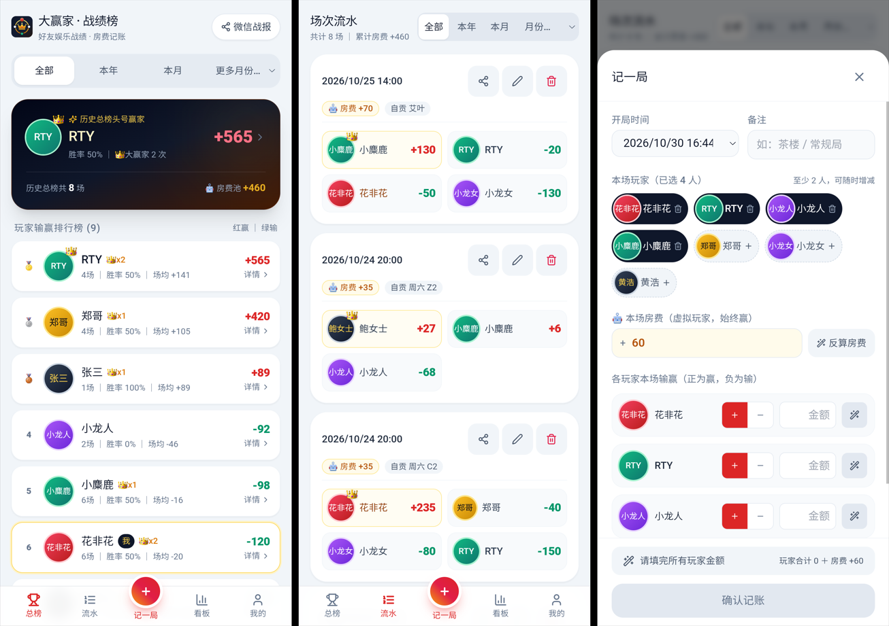
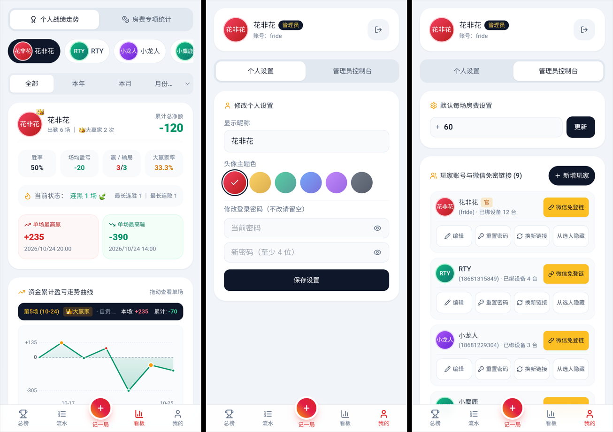
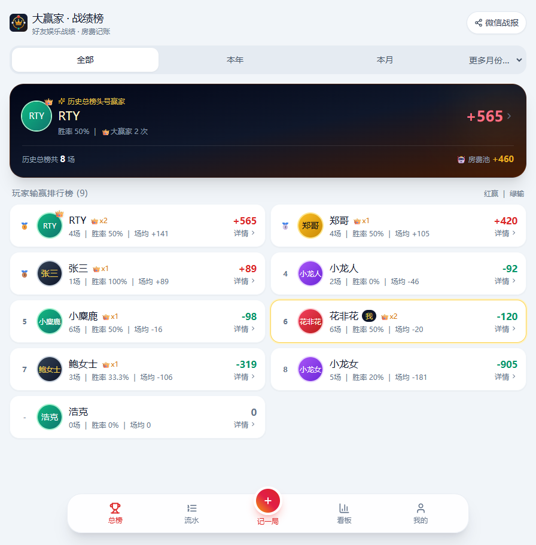
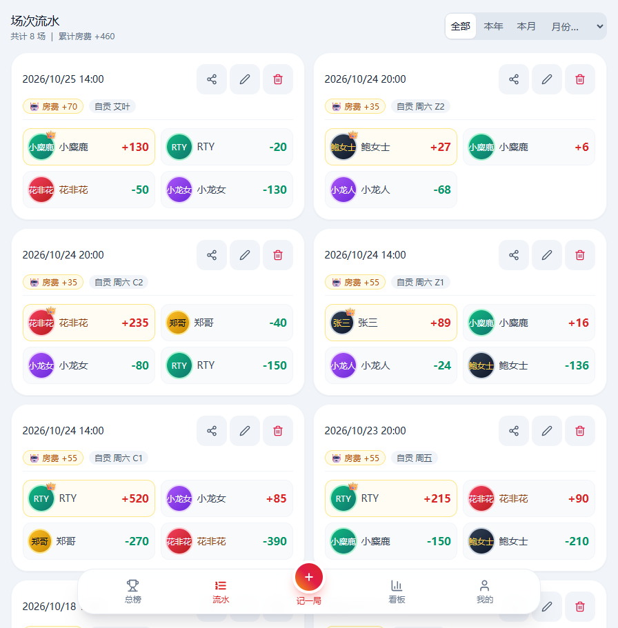

<div align="center">


# 大赢家 BigWinner

好友娱乐战绩与房费记账系统

[](https://github.com/FrideKro/BigWinner/actions/workflows/ci.yaml)
[](https://github.com/FrideKro/BigWinner/releases)
[](https://github.com/FrideKro/BigWinner/pkgs/container/bigwinner)
[](LICENSE)

</div>

## 目录

- [功能特性](#功能特性)
- [产品截图](#产品截图)
- [快速部署](#快速部署)
- [配置说明](#配置说明)
- [本地开发](#本地开发)
- [项目结构](#项目结构)
- [许可证](#许可证)

## 功能特性

- **零和配平**：房费作为台面上的虚拟玩家（恒为 ≥ 0 的整数），每场必须满足 `Σ 玩家净输赢 + 房费 = 0`，否则拒绝保存；默认 4 人开局，支持 2~N 人增减，可一键反算房费或自动配平最后一名玩家
- **大赢家 👑**：单场得分最高且 > 0 者自动获得称号，允许多人并列
- **微信免密登录**：设备 Token 存于 Cookie + LocalStorage 双通道，每次访问滑动续期 365 天；数据库只存 Token 的 SHA-256 哈希，明文不落库
- **激活链接**：管理员一键复制好友专属「免登激活链接」，好友在微信里点开一次即绑定本机，之后点群里任何战报链接都自动登录
- **群战报分享**：单场战绩与排行榜一键复制带 Emoji 的微信群文案和访问链接
- **统计与走势**：个人累计盈亏走势图、巅峰局 / 至暗局、连胜连败、月度房费汇总，红赢绿输
- **登录防爆破**：同一「账号 + IP」15 分钟内失败 5 次锁定 15 分钟（另有账号维度兜底；进程内限流，重启后重置）；重置密码时同步下线该玩家全部设备
- **停用即隔离**：隐藏（停用）的玩家无法登录、无法绑定新设备、已发 Token 立即失效，且不能被录入新战绩；历史战绩保留，重新启用即恢复
- **PWA**：可添加到手机主屏幕，以独立 App 形式打开

## 产品截图

移动端（微信内置浏览器）：

<p align="center">
  
  
</p>

宽屏（平板 / 桌面浏览器）：

<p align="center">
  
  
</p>

## 快速部署

```
ghcr.io/fridekro/bigwinner
```

| Tag      | 说明                     |
| -------- | ------------------------ |
| `latest` | 最新正式版               |
| `1.0`    | 1.0.x 系列最新补丁版     |
| `1.0.0`  | 固定版本（生产环境推荐） |

> 镜像目前只提供 `linux/amd64`，ARM 设备（树莓派、部分 NAS / VPS）请参考[方式三：自行构建镜像](#方式三自行构建镜像)

### 前置条件

- Docker 20.10+ 与 Docker Compose v2（`docker compose` 子命令）
- PostgreSQL 13+（可以按方式一随应用一起启动，也可以连接已有数据库）

### 方式一：Docker Compose 一键启动（含数据库，推荐）

新建一个目录（如 `/opt/big-winner`），放入以下两个文件

`docker-compose.yml`：

```yaml
services:
  db:
    image: postgres:17
    restart: unless-stopped
    environment:
      POSTGRES_DB: big_winner
      POSTGRES_USER: big_winner
      POSTGRES_PASSWORD: ${DB_PASSWORD:?请在 .env 中设置 DB_PASSWORD}
    volumes:
      - pgdata:/var/lib/postgresql/data
    healthcheck:
      test: ['CMD-SHELL', 'pg_isready -U big_winner -d big_winner']
      interval: 5s
      timeout: 5s
      retries: 10

  app:
    image: ghcr.io/fridekro/bigwinner:${IMAGE_TAG:-latest}
    restart: unless-stopped
    depends_on:
      db:
        condition: service_healthy
    ports:
      - '${APP_PORT:-3000}:3000'
    env_file: .env
    environment:
      DB_HOST: db
    healthcheck:
      test: ['CMD', 'node', 'healthcheck.js']
      interval: 20s
      timeout: 5s
      retries: 3
      start_period: 15s

volumes:
  pgdata:
```

`.env`：

```dotenv
DB_PASSWORD=请改成强密码
ADMIN_PASSWORD=请改成管理员密码
# IMAGE_TAG=1.0.0      # 固定版本，留空为 latest
# APP_PORT=3000        # 宿主机端口
# COOKIE_SECURE=true   # 走 HTTPS 时开启
```

启动：

```bash
docker compose up -d
docker compose ps        # 两个容器均为 healthy 即启动成功
```

浏览器访问 `http://服务器IP:3000`，用管理员账号 `admin` 和 `.env` 中的 `ADMIN_PASSWORD` 登录。首次启动会自动建表并创建管理员，无需手动执行任何 SQL

### 方式二：连接已有 PostgreSQL

先在数据库中准备库和用户（该用户需要 `public` schema 的建表权限）：

```sql
CREATE USER big_winner WITH PASSWORD '你的密码';
CREATE DATABASE big_winner OWNER big_winner;
```

然后直接运行容器：

```bash
docker run -d --name big_winner_app --restart unless-stopped \
  -p 3000:3000 \
  -e DB_HOST=数据库地址 \
  -e DB_PASSWORD=你的密码 \
  -e ADMIN_PASSWORD=管理员密码 \
  ghcr.io/fridekro/bigwinner:latest
```

> 容器内的 `127.0.0.1` 指向容器自身。数据库在宿主机上时，`DB_HOST` 请填宿主机局域网 IP，或加 `--add-host=host.docker.internal:host-gateway` 后填 `host.docker.internal`

也可以把变量写进 `.env` 后用 `--env-file .env` 传入；或使用仓库自带的 [`docker-compose.yml`](docker-compose.yml)，在 `.env` 中设置 `IMAGE_NAME=ghcr.io/fridekro/bigwinner` 后执行 `docker compose up -d`

### 方式三：自行构建镜像

适用于 ARM 设备或需要修改代码的场景：

```bash
git clone https://github.com/FrideKro/BigWinner.git
cd BigWinner
cp .env.example .env     # 编辑数据库连接与管理员密码
docker compose up -d --build
```

### 生产环境建议

- **启用 HTTPS**：通过 Nginx / Caddy 等反向代理提供 HTTPS，微信内的剪贴板 API 与 PWA 安装都要求安全上下文；启用后把 `COOKIE_SECURE` 设为 `true`
- **透传客户端 IP**：反向代理需设置 `X-Forwarded-For` 请求头，登录限流才能按「账号 + IP」生效
- **修改默认密码**：未设置 `ADMIN_PASSWORD` 时管理员密码为 `admin@123456`（启动日志会给出警告），请务必修改
- **固定镜像版本**：在 `.env` 中设置 `IMAGE_TAG=1.0.0` 之类的固定版本，避免重建容器时意外升级

Caddy 示例（自动申请证书）：

```caddyfile
bigwinner.example.com {
    reverse_proxy 127.0.0.1:3000
}
```

## 配置说明

所有配置通过环境变量传入，完整注释见 [`.env.example`](.env.example)。

| 变量               | 默认值                 | 说明                                                                             |
| ------------------ | ---------------------- | -------------------------------------------------------------------------------- |
| `DB_HOST`          | `127.0.0.1`            | 数据库地址，Docker 部署必填                                                      |
| `DB_PORT`          | `5432`                 | 数据库端口                                                                       |
| `DB_NAME`          | `big_winner`           | 数据库名                                                                         |
| `DB_USER`          | `big_winner`           | 数据库用户                                                                       |
| `DB_PASSWORD`      | 空                     | 数据库密码，Docker 部署必填                                                      |
| `DB_SSLMODE`       | `disable`              | `disable` / `require` / `verify-full`                                            |
| `DATABASE_URL`     | 空                     | 设置后优先使用此连接串，忽略上面的 `DB_*`                                        |
| `ADMIN_USERNAME`   | `admin`                | 初始管理员账号（仅首次初始化生效）                                               |
| `ADMIN_NICKNAME`   | `管理员`               | 初始管理员昵称（仅首次初始化生效）                                               |
| `ADMIN_PASSWORD`   | `admin@123456`         | 初始管理员密码（仅首次初始化生效）                                               |
| `DEFAULT_ROOM_FEE` | `100`                  | 单场默认房费（仅首次初始化生效，之后在应用内修改）                               |
| `COOKIE_SECURE`    | `false`                | Cookie 是否带 `Secure` 标记，HTTPS 部署设为 `true`                               |
| `APP_PORT`         | `3000`                 | 宿主机映射端口（仅 docker compose 使用）                                         |
| `IMAGE_NAME`       | `localhost/big-winner` | 仓库自带 compose 与部署脚本使用的镜像名，官方镜像填 `ghcr.io/fridekro/bigwinner` |
| `IMAGE_TAG`        | `latest`               | 镜像版本（仅 docker compose 与部署脚本使用）                                     |

## 本地开发

环境要求：Node.js 24、pnpm 12、PostgreSQL 13+

```bash
pnpm install
cp .env.example .env                  # 填写本地数据库连接
node scripts/test-db-connection.mjs   # 可选：验证数据库连通性
pnpm dev                              # http://localhost:3000
```

| 命令             | 说明                                   |
| ---------------- | -------------------------------------- |
| `pnpm dev`       | 启动开发服务器                         |
| `pnpm build`     | 生产构建（包含 ESLint 检查）           |
| `pnpm lint`      | ESLint 检查（`lint:fix` 自动修复）     |
| `pnpm format`    | Prettier 格式化（`format:check` 校验） |
| `pnpm typecheck` | TypeScript 类型检查                    |
| `pnpm test`      | 运行单元测试（`test:watch` 监听模式）  |

技术栈：Next.js 15（App Router）、React 19、TypeScript、Tailwind CSS 3、PostgreSQL（`pg` 裸 SQL，无 ORM）、Vitest + Testing Library

## 项目结构

```
src/
├── app/
│   ├── api/          # REST 路由：auth、bootstrap、games、users、stats、settings、health
│   ├── games/        # 对局记录
│   ├── stats/        # 统计排行
│   ├── profile/      # 个人中心 / 玩家管理
│   ├── login/        # 登录
│   └── bind/         # 激活链接绑定
├── components/       # 通用组件（对局编辑、头像、走势图、弹窗等）
└── lib/              # 核心业务：记账校验、数据库、认证、格式化
scripts/              # 部署脚本、数据库连通性测试
```

## 许可证

[MIT](LICENSE) © 2026 花非花
